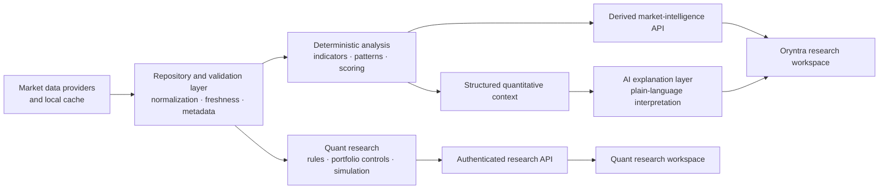

<div align="center">


# Oryntra AI

### Market Intelligence · Systematic Research · Explainable Analysis

**Research before the decision.**

Oryntra is a market-research platform from **Cowles Quantitative Corporation (CQC)** designed to help investors inspect securities, test ideas, understand risk, and make their own decisions using a more structured and evidence-driven process.

</div>

---

> **Research software, not an investment adviser.**
> Oryntra provides research, historical analysis, and educational tools. It does not manage customer assets, place brokerage orders, guarantee results, or tell users what securities they must buy or sell. Historical simulations are analytical outputs, not forecasts or promises of future performance.

> **Ownership and product boundary.**
> Oryntra is owned and operated by **Cowles Quantitative Corporation**. Oryntra is a customer-facing research product. CQC's private proprietary quantitative research, portfolio-allocation research, and any future use of company-owned capital are separate from the public Oryntra workflow.

---

# What Oryntra Is

Oryntra is built around a simple idea:

**Good research should make the evidence, assumptions, risks, and limitations visible.**

Instead of presenting users with a mysterious score or pretending markets can be predicted with certainty, Oryntra combines deterministic market analysis, structured research workflows, historical testing, portfolio diagnostics, and plain-language explanation.

The goal is not to manufacture certainty.

The goal is to make research more disciplined.

Oryntra can help a user:

- inspect a security before acting;
- review technical and market conditions;
- identify structured market setups;
- test clearly defined historical rules;
- compare return and risk;
- evaluate concentration and portfolio behavior;
- preserve research over time;
- inspect assumptions behind a result;
- understand when historical evidence is weak;
- separate quantitative calculations from explanatory AI.

---

# Where Oryntra Fits Inside CQC

Cowles Quantitative Corporation is developing customer software alongside a separate private quantitative research system.

The customer workflow is intentionally simple:

### Oryntra
**Research before a decision.**

Investigate securities, market conditions, historical behavior, risk, and systematic research evidence.

### Rule Mirror
**Review after a decision.**

Import brokerage activity, reconstruct trades, analyze outcomes, and measure whether actual behavior followed the process or rules the user intended to follow.

### CQC Proprietary Research
**Private quantitative R&D.**

CQC separately develops and evaluates quantitative models, portfolio-construction systems, risk controls, data infrastructure, and research methods for internal company use.

The public Oryntra product is not a public interface to CQC's private capital-allocation research.

---

# What Oryntra Provides

| Area | Oryntra provides | Oryntra does not provide |
| --- | --- | --- |
| Market intelligence | Derived technical states, indicators, pattern observations, setup analysis, and explainable summaries | Guaranteed predictions |
| Security research | Structured single-ticker research and historical context | Personalized investment advice |
| Systematic research | Transparent rules, historical simulations, configurable assumptions, holdouts, and diagnostics | Proof that a strategy will work in the future |
| Portfolio analysis | Risk, concentration, volatility, turnover, correlation, and historical portfolio diagnostics | Customer asset management |
| Data handling | Provider-aware retrieval, local caching, validation, metadata, and reproducibility controls | A license to redistribute restricted vendor data |
| AI | Plain-language interpretation of structured server-side research | AI-generated market facts or untraceable numeric calculations |
| Product operation | Authentication, watchlists, saved research, research workspaces, and account controls | Brokerage execution or discretionary trading |

---

# Product Philosophy

## 1. Evidence before narrative

Numerical calculations should come from deterministic systems wherever practical.

AI explanation can help communicate a result, but it should not quietly invent the result.

Indicators, pattern states, portfolio statistics, historical returns, and risk measurements are produced from structured calculations before they reach the explanation layer.

---

## 2. A signal is a hypothesis

Oryntra does not treat an indicator or historical pattern as automatic proof of future direction.

RSI, moving averages, MACD, Bollinger Bands, ATR, ADX, breakouts, pullbacks, relative strength, volatility conditions, and other measurements are evidence describing a market state.

They remain hypotheses until tested.

---

## 3. Risk belongs beside return

A historical result without its risk profile is incomplete.

Oryntra's research architecture is designed to evaluate return alongside measurements such as:

- drawdown;
- volatility;
- turnover;
- concentration;
- correlation;
- exposure;
- liquidity assumptions;
- historical value at risk;
- expected shortfall;
- data coverage;
- regime behavior;
- transaction-cost assumptions.

---

## 4. Reproducibility matters

A useful research result should be possible to inspect and reproduce.

Where practical, Oryntra records information such as:

- requested universe;
- model or rule configuration;
- historical period;
- dataset source;
- provider metadata;
- cost assumptions;
- rebalance assumptions;
- portfolio constraints;
- dataset fingerprints;
- holdout periods;
- generated diagnostics.

---

## 5. Failed research is still information

Oryntra is not designed around showing only attractive historical results.

A research hypothesis that fails under realistic costs, later periods, different securities, or stricter controls should be documented as a failure rather than quietly retuned until the chart looks better.

That principle is central to CQC's broader research culture.

---

# System at a Glance



# Current Implementation

The repository contains the browser workspace, Flutter iOS client, FastAPI backend, and experimental research modules. Publishing their source does not enable a research route, deploy a service, or qualify a model for live use.

| Component | Implemented scope | Source |
| --- | --- | --- |
| Web workspace | Account access, watchlists, saved research, scanner analysis, membership UI, and a fixed synthetic demo | [Frontend](server/frontend/), [API composition](server/backend/main.py) |
| iOS app | Native account flow, hosted security challenge, research screens, memberships, and local saved reports | [Flutter app](ios-app/) |
| Billing and authentication | Hosted subscription checkout and portal requests, signed lifecycle webhooks, and Turnstile verification | [Billing](server/backend/routes/billing.py), [authentication](server/backend/routes/auth.py) |
| Alpha and Beta | Configurable research models, point-in-time availability rules, and macro/regime context | [Model packages](server/backend/models/) |
| QOptima, Gamma, and risk | Experimental portfolio construction, forecast/risk contracts, and causal regression tests | [QOptima](server/backend/qoptima/), [Gamma](server/gamma_v1/), [QPO/Gamma](server/qpo_gamma/), [risk](server/backend/risk/) |
| Delta engineering | C++ reported-volume engine, exact Python oracle, disabled uncertainty projector, synthetic journal, and diagnostic math | [Delta package](server/backend/delta/README.md) |

The public Quant Lab uses a fixed documented profile; its internal research controls are separate. Private research routes are disabled by default and require explicit configuration. A private integration boundary is not an enabled public brokerage service.

The demo uses repeatable invented data, not live quotes. Billing configuration and provider credentials are deployment inputs; they are not included in this repository.

## Research status

These modules are research implementations, not established trading edge. Delta's saved single-versus-joint comparison reduced error by approximately **0.2894%**, below its preset **1%** screen. That reused April result does not demonstrate an improved Sharpe ratio or an independent holdout success. Native arithmetic and synthetic regression checks establish their tested engineering behavior, not profitability or execution readiness.

The Delta model-vector bridge remains disabled. Its artifact-specific raw reader and process-custody integration remain local pending a separate portable-runtime review. See the [development map](docs/DEVELOPMENT_UPDATES.md) for package boundaries, evidence, and limitations.

# Running Locally

From a checkout with Python installed:

```bash
cd server
python3 -m venv .venv
.venv/bin/python -m pip install -r requirements.txt
cp .env.example .env
.venv/bin/python run.py
```

Review the example configuration before starting the service. The default port is `8001`; `/health` reports API health. The example enables the browser page while leaving private research routes and public Quant Lab access disabled. Provider-backed analysis, billing, and sign-in protection require their own authorized configuration. The fixed demo does not require a provider key.

Optional Gamma model tests use [requirements-research.txt](server/requirements-research.txt). The iOS client uses Flutter and declares its assets and dependencies in [pubspec.yaml](ios-app/pubspec.yaml).

## Verification

Backend, from `server`:

```bash
PYTHONPATH=. .venv/bin/python -m pytest tests
node --check frontend/static/js/app.js
```

iOS, from `ios-app`:

```bash
flutter pub get
flutter analyze
flutter test
```

Delta's native checks currently target macOS CommonCrypto with C++17, ASan, and UBSan. Build instructions and scope are in the [Delta package README](server/backend/delta/README.md). Passing these checks does not deploy or sign an app.

# Data and Reproducibility

Raw vendor market data, price/prediction/model caches, credentials, private company documents, the Obsidian vault, environments, and large backups remain local. A source checkout is not a bundled research dataset or permission to redistribute provider data. Some research workflows require separately supplied local artifacts and fail when their required inputs are unavailable.

The owner checkout keeps an ignored data-location index under `local-artifacts/`; machine-specific paths and private payloads are not part of the public repository. Frozen experiment artifacts retain their original local paths. Public source, synthetic tests, and sanitized research summaries are organized through the [development map](docs/DEVELOPMENT_UPDATES.md).
